# catppuccin-accents theme previews

> [!TIP]
> Open a preview for a larger view. Expand **Capture details** for rendering information and palette sources.

## Catppuccin Frappé Flamingo

| Regular | ANSI |
| --- | --- |
| [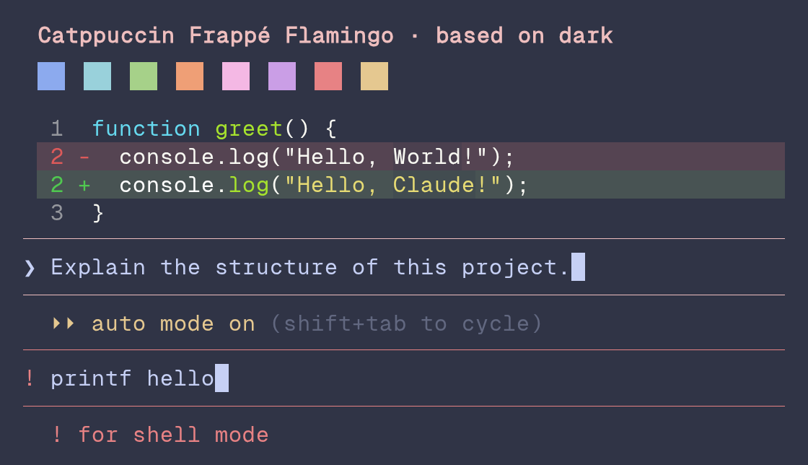](renders/catppuccin-frappe-flamingo.png) | Not supplied |

Capture details

Combined screenshot crops from **Claude Code 2.1.278**, using **Geist Mono**.

- **Pixels:** Preserved from the original screenshots.
- **Swatches:** Agent colours.
- **Syntax highlighting:** Regular: `Monokai Extended`.
- **Examples:** Auto mode and a shell prompt.

[Terminal palette source](https://github.com/catppuccin/palette/blob/07d02aa110ef9eb7e7427afca5c73ba9cf7f8ebd/palette.json).

## Catppuccin Frappé Green

| Regular | ANSI |
| --- | --- |
| [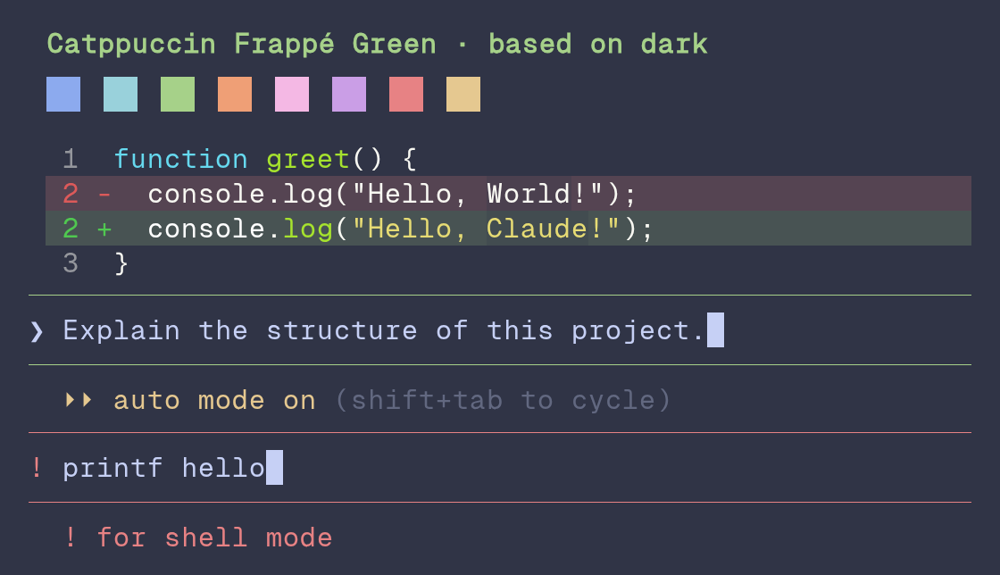](renders/catppuccin-frappe-green.png) | Not supplied |

Capture details

Combined screenshot crops from **Claude Code 2.1.278**, using **Geist Mono**.

- **Pixels:** Preserved from the original screenshots.
- **Swatches:** Agent colours.
- **Syntax highlighting:** Regular: `Monokai Extended`.
- **Examples:** Auto mode and a shell prompt.

[Terminal palette source](https://github.com/catppuccin/palette/blob/07d02aa110ef9eb7e7427afca5c73ba9cf7f8ebd/palette.json).

## Catppuccin Frappé Lavender

| Regular | ANSI |
| --- | --- |
|  | Not supplied |

Capture details

Combined screenshot crops from **Claude Code 2.1.278**, using **Geist Mono**.

- **Pixels:** Preserved from the original screenshots.
- **Swatches:** Agent colours.
- **Syntax highlighting:** Regular: `Monokai Extended`.
- **Examples:** Auto mode and a shell prompt.

[Terminal palette source](https://github.com/catppuccin/palette/blob/07d02aa110ef9eb7e7427afca5c73ba9cf7f8ebd/palette.json).

## Catppuccin Frappé Maroon

| Regular | ANSI |
| --- | --- |
| [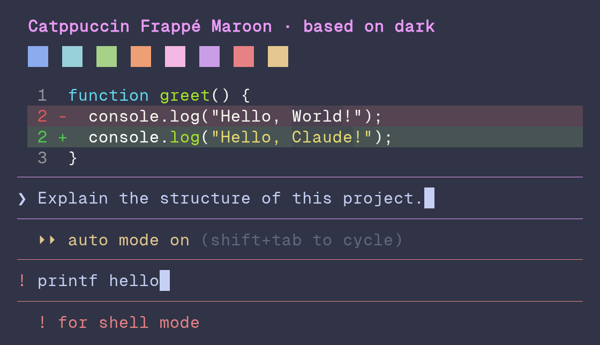](renders/catppuccin-frappe-maroon.png) | Not supplied |

Capture details

Combined screenshot crops from **Claude Code 2.1.278**, using **Geist Mono**.

- **Pixels:** Preserved from the original screenshots.
- **Swatches:** Agent colours.
- **Syntax highlighting:** Regular: `Monokai Extended`.
- **Examples:** Auto mode and a shell prompt.

[Terminal palette source](https://github.com/catppuccin/palette/blob/07d02aa110ef9eb7e7427afca5c73ba9cf7f8ebd/palette.json).

## Catppuccin Frappé Mauve

| Regular | ANSI |
| --- | --- |
| [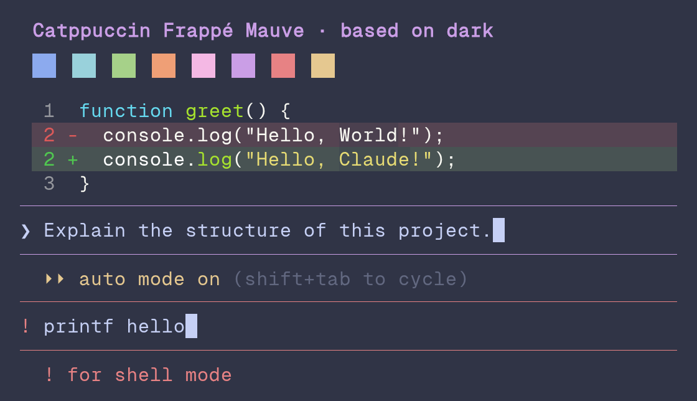](renders/catppuccin-frappe-mauve.png) | Not supplied |

Capture details

Combined screenshot crops from **Claude Code 2.1.278**, using **Geist Mono**.

- **Pixels:** Preserved from the original screenshots.
- **Swatches:** Agent colours.
- **Syntax highlighting:** Regular: `Monokai Extended`.
- **Examples:** Auto mode and a shell prompt.

[Terminal palette source](https://github.com/catppuccin/palette/blob/07d02aa110ef9eb7e7427afca5c73ba9cf7f8ebd/palette.json).

## Catppuccin Frappé Peach

| Regular | ANSI |
| --- | --- |
| [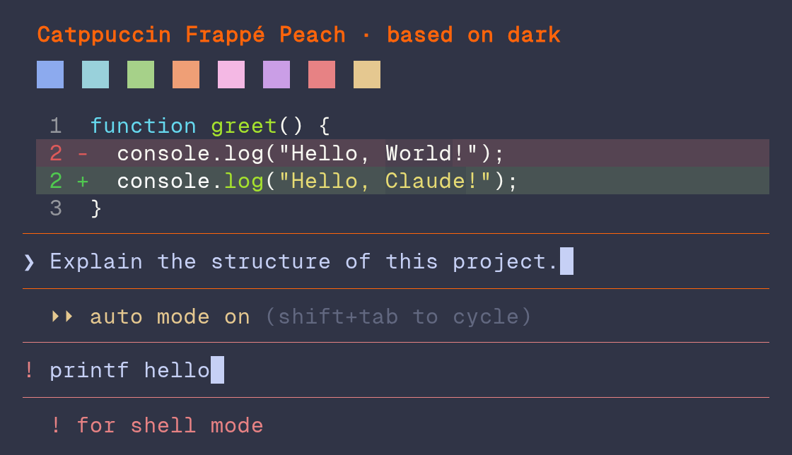](renders/catppuccin-frappe-peach.png) | Not supplied |

Capture details

Combined screenshot crops from **Claude Code 2.1.278**, using **Geist Mono**.

- **Pixels:** Preserved from the original screenshots.
- **Swatches:** Agent colours.
- **Syntax highlighting:** Regular: `Monokai Extended`.
- **Examples:** Auto mode and a shell prompt.

[Terminal palette source](https://github.com/catppuccin/palette/blob/07d02aa110ef9eb7e7427afca5c73ba9cf7f8ebd/palette.json).

## Catppuccin Frappé Pink

| Regular | ANSI |
| --- | --- |
| [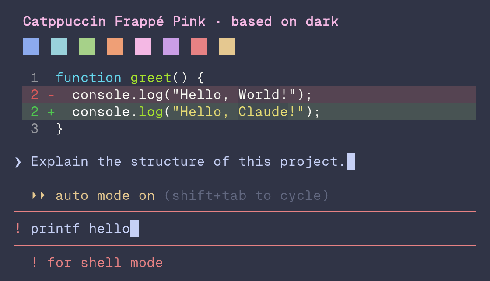](renders/catppuccin-frappe-pink.png) | Not supplied |

Capture details

Combined screenshot crops from **Claude Code 2.1.278**, using **Geist Mono**.

- **Pixels:** Preserved from the original screenshots.
- **Swatches:** Agent colours.
- **Syntax highlighting:** Regular: `Monokai Extended`.
- **Examples:** Auto mode and a shell prompt.

[Terminal palette source](https://github.com/catppuccin/palette/blob/07d02aa110ef9eb7e7427afca5c73ba9cf7f8ebd/palette.json).

## Catppuccin Frappé Red

| Regular | ANSI |
| --- | --- |
| [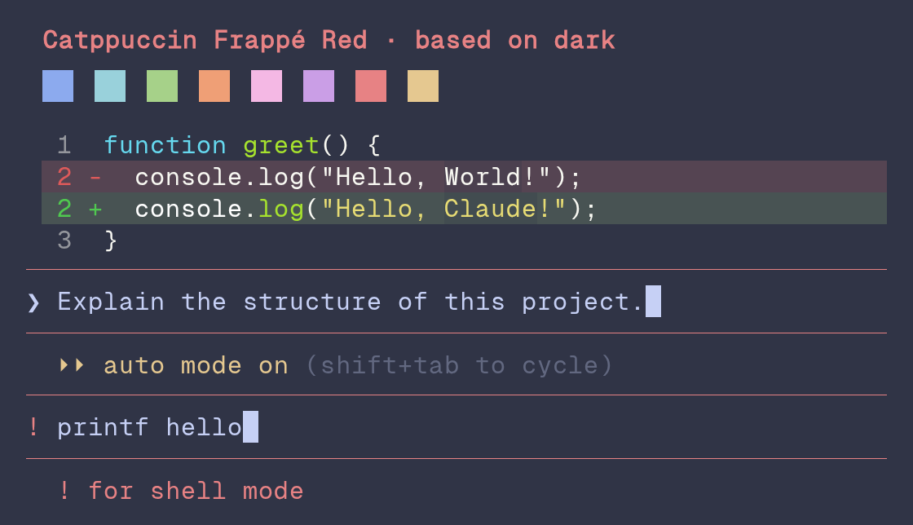](renders/catppuccin-frappe-red.png) | Not supplied |

Capture details

Combined screenshot crops from **Claude Code 2.1.278**, using **Geist Mono**.

- **Pixels:** Preserved from the original screenshots.
- **Swatches:** Agent colours.
- **Syntax highlighting:** Regular: `Monokai Extended`.
- **Examples:** Auto mode and a shell prompt.

[Terminal palette source](https://github.com/catppuccin/palette/blob/07d02aa110ef9eb7e7427afca5c73ba9cf7f8ebd/palette.json).

## Catppuccin Frappé Rosewater

| Regular | ANSI |
| --- | --- |
| [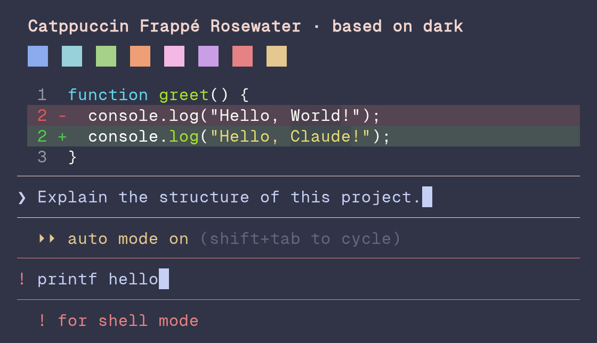](renders/catppuccin-frappe-rosewater.png) | Not supplied |

Capture details

Combined screenshot crops from **Claude Code 2.1.278**, using **Geist Mono**.

- **Pixels:** Preserved from the original screenshots.
- **Swatches:** Agent colours.
- **Syntax highlighting:** Regular: `Monokai Extended`.
- **Examples:** Auto mode and a shell prompt.

[Terminal palette source](https://github.com/catppuccin/palette/blob/07d02aa110ef9eb7e7427afca5c73ba9cf7f8ebd/palette.json).

## Catppuccin Frappé Sapphire

| Regular | ANSI |
| --- | --- |
| [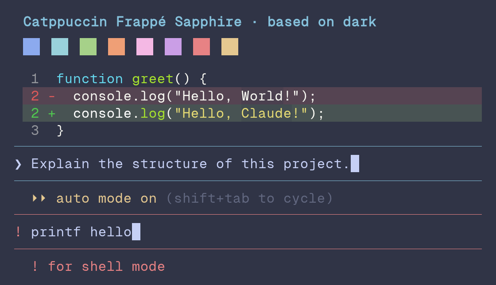](renders/catppuccin-frappe-sapphire.png) | Not supplied |

Capture details

Combined screenshot crops from **Claude Code 2.1.278**, using **Geist Mono**.

- **Pixels:** Preserved from the original screenshots.
- **Swatches:** Agent colours.
- **Syntax highlighting:** Regular: `Monokai Extended`.
- **Examples:** Auto mode and a shell prompt.

[Terminal palette source](https://github.com/catppuccin/palette/blob/07d02aa110ef9eb7e7427afca5c73ba9cf7f8ebd/palette.json).

## Catppuccin Frappé Sky

| Regular | ANSI |
| --- | --- |
| [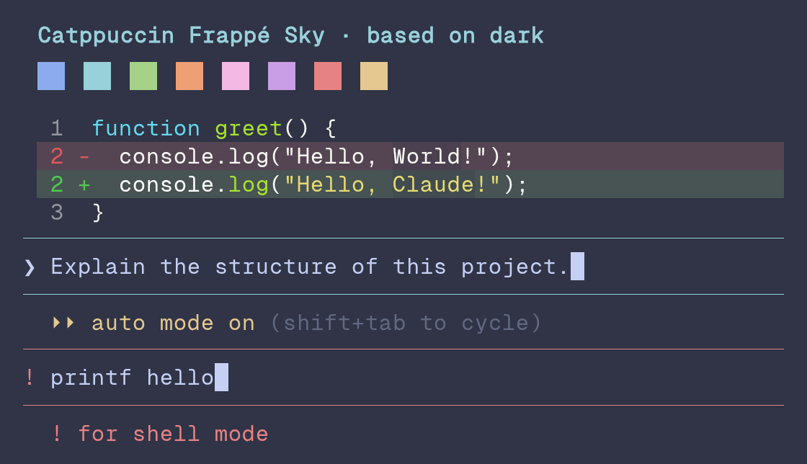](renders/catppuccin-frappe-sky.png) | Not supplied |

Capture details

Combined screenshot crops from **Claude Code 2.1.278**, using **Geist Mono**.

- **Pixels:** Preserved from the original screenshots.
- **Swatches:** Agent colours.
- **Syntax highlighting:** Regular: `Monokai Extended`.
- **Examples:** Auto mode and a shell prompt.

[Terminal palette source](https://github.com/catppuccin/palette/blob/07d02aa110ef9eb7e7427afca5c73ba9cf7f8ebd/palette.json).

## Catppuccin Frappé Teal

| Regular | ANSI |
| --- | --- |
|  | Not supplied |

Capture details

Combined screenshot crops from **Claude Code 2.1.278**, using **Geist Mono**.

- **Pixels:** Preserved from the original screenshots.
- **Swatches:** Agent colours.
- **Syntax highlighting:** Regular: `Monokai Extended`.
- **Examples:** Auto mode and a shell prompt.

[Terminal palette source](https://github.com/catppuccin/palette/blob/07d02aa110ef9eb7e7427afca5c73ba9cf7f8ebd/palette.json).

## Catppuccin Frappé Yellow

| Regular | ANSI |
| --- | --- |
| [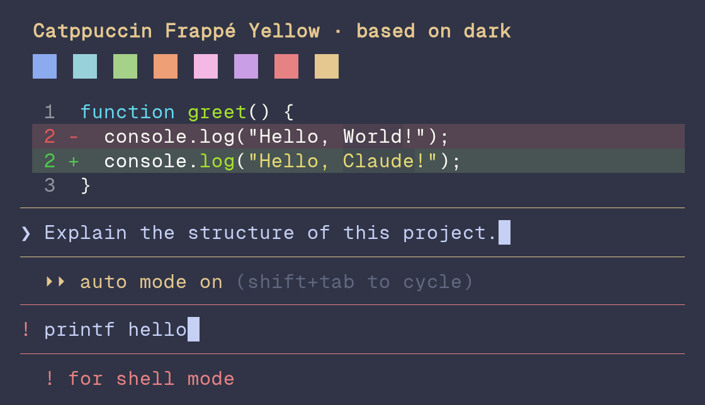](renders/catppuccin-frappe-yellow.png) | Not supplied |

Capture details

Combined screenshot crops from **Claude Code 2.1.278**, using **Geist Mono**.

- **Pixels:** Preserved from the original screenshots.
- **Swatches:** Agent colours.
- **Syntax highlighting:** Regular: `Monokai Extended`.
- **Examples:** Auto mode and a shell prompt.

[Terminal palette source](https://github.com/catppuccin/palette/blob/07d02aa110ef9eb7e7427afca5c73ba9cf7f8ebd/palette.json).

## Catppuccin Latte Flamingo

| Regular | ANSI |
| --- | --- |
|  | Not supplied |

Capture details

Combined screenshot crops from **Claude Code 2.1.278**, using **Geist Mono**.

- **Pixels:** Preserved from the original screenshots.
- **Swatches:** Agent colours.
- **Syntax highlighting:** Regular: `GitHub`.
- **Examples:** Auto mode and a shell prompt.

[Terminal palette source](https://github.com/catppuccin/palette/blob/07d02aa110ef9eb7e7427afca5c73ba9cf7f8ebd/palette.json).

## Catppuccin Latte Green

| Regular | ANSI |
| --- | --- |
| [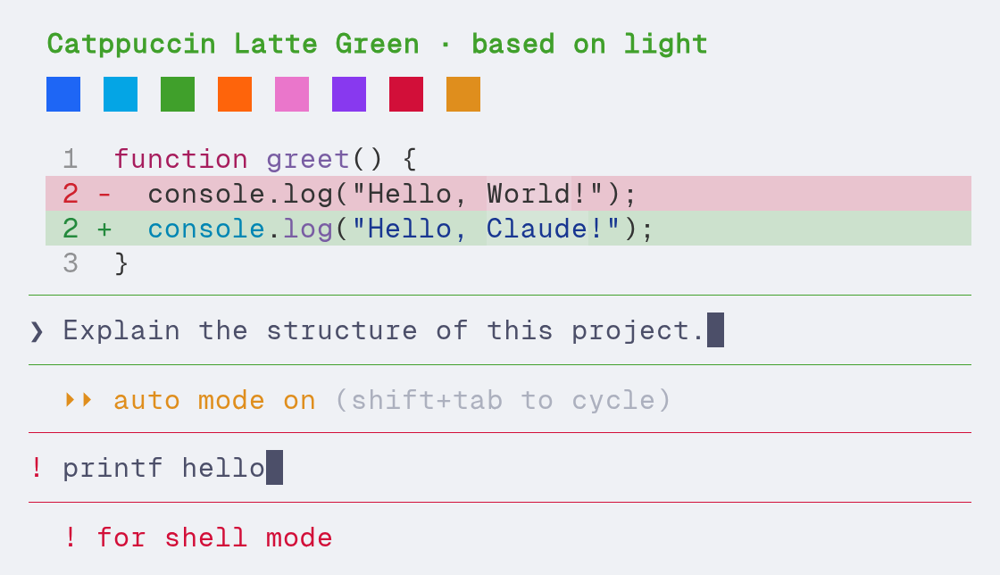](renders/catppuccin-latte-green.png) | Not supplied |

Capture details

Combined screenshot crops from **Claude Code 2.1.278**, using **Geist Mono**.

- **Pixels:** Preserved from the original screenshots.
- **Swatches:** Agent colours.
- **Syntax highlighting:** Regular: `GitHub`.
- **Examples:** Auto mode and a shell prompt.

[Terminal palette source](https://github.com/catppuccin/palette/blob/07d02aa110ef9eb7e7427afca5c73ba9cf7f8ebd/palette.json).

## Catppuccin Latte Lavender

| Regular | ANSI |
| --- | --- |
| [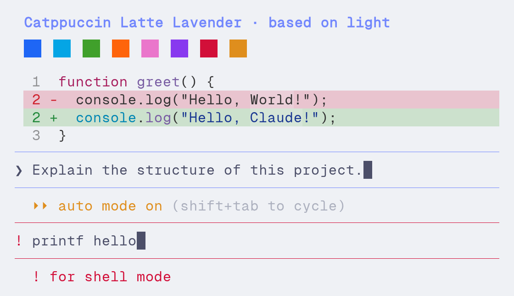](renders/catppuccin-latte-lavender.png) | Not supplied |

Capture details

Combined screenshot crops from **Claude Code 2.1.278**, using **Geist Mono**.

- **Pixels:** Preserved from the original screenshots.
- **Swatches:** Agent colours.
- **Syntax highlighting:** Regular: `GitHub`.
- **Examples:** Auto mode and a shell prompt.

[Terminal palette source](https://github.com/catppuccin/palette/blob/07d02aa110ef9eb7e7427afca5c73ba9cf7f8ebd/palette.json).

## Catppuccin Latte Maroon

| Regular | ANSI |
| --- | --- |
| [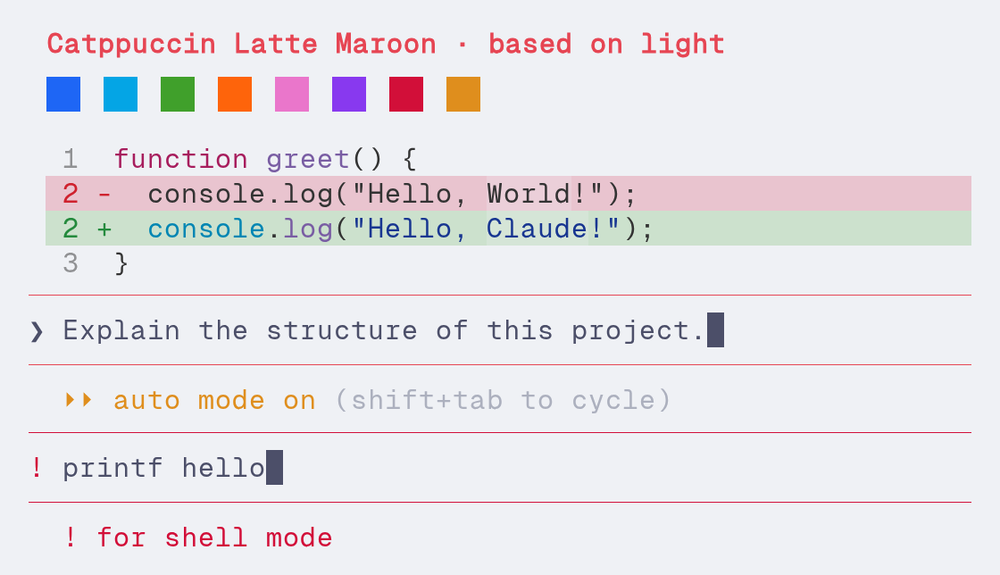](renders/catppuccin-latte-maroon.png) | Not supplied |

Capture details

Combined screenshot crops from **Claude Code 2.1.278**, using **Geist Mono**.

- **Pixels:** Preserved from the original screenshots.
- **Swatches:** Agent colours.
- **Syntax highlighting:** Regular: `GitHub`.
- **Examples:** Auto mode and a shell prompt.

[Terminal palette source](https://github.com/catppuccin/palette/blob/07d02aa110ef9eb7e7427afca5c73ba9cf7f8ebd/palette.json).

## Catppuccin Latte Mauve

| Regular | ANSI |
| --- | --- |
| [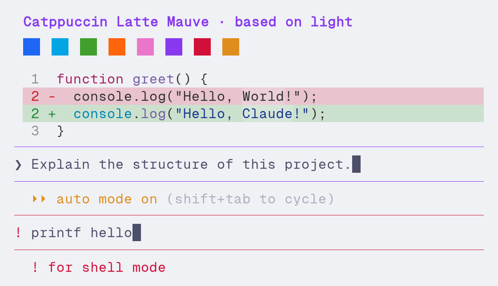](renders/catppuccin-latte-mauve.png) | Not supplied |

Capture details

Combined screenshot crops from **Claude Code 2.1.278**, using **Geist Mono**.

- **Pixels:** Preserved from the original screenshots.
- **Swatches:** Agent colours.
- **Syntax highlighting:** Regular: `GitHub`.
- **Examples:** Auto mode and a shell prompt.

[Terminal palette source](https://github.com/catppuccin/palette/blob/07d02aa110ef9eb7e7427afca5c73ba9cf7f8ebd/palette.json).

## Catppuccin Latte Peach

| Regular | ANSI |
| --- | --- |
| [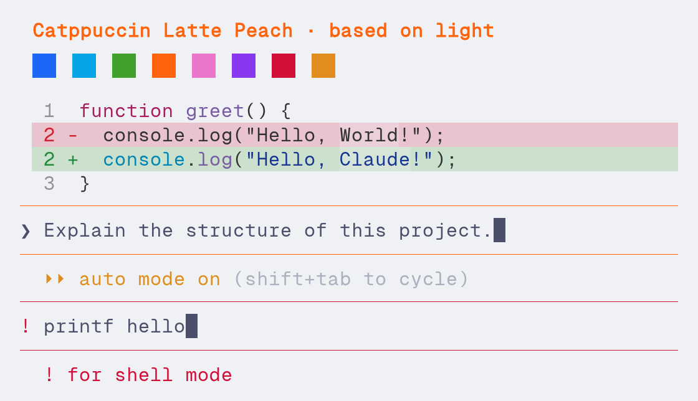](renders/catppuccin-latte-peach.png) | Not supplied |

Capture details

Combined screenshot crops from **Claude Code 2.1.278**, using **Geist Mono**.

- **Pixels:** Preserved from the original screenshots.
- **Swatches:** Agent colours.
- **Syntax highlighting:** Regular: `GitHub`.
- **Examples:** Auto mode and a shell prompt.

[Terminal palette source](https://github.com/catppuccin/palette/blob/07d02aa110ef9eb7e7427afca5c73ba9cf7f8ebd/palette.json).

## Catppuccin Latte Pink

| Regular | ANSI |
| --- | --- |
| [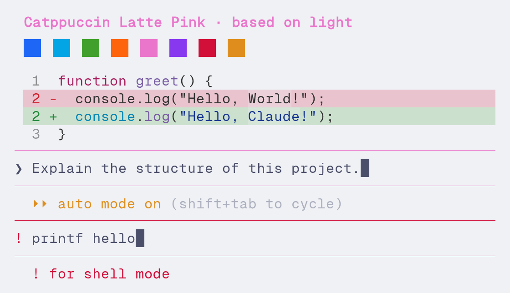](renders/catppuccin-latte-pink.png) | Not supplied |

Capture details

Combined screenshot crops from **Claude Code 2.1.278**, using **Geist Mono**.

- **Pixels:** Preserved from the original screenshots.
- **Swatches:** Agent colours.
- **Syntax highlighting:** Regular: `GitHub`.
- **Examples:** Auto mode and a shell prompt.

[Terminal palette source](https://github.com/catppuccin/palette/blob/07d02aa110ef9eb7e7427afca5c73ba9cf7f8ebd/palette.json).

## Catppuccin Latte Red

| Regular | ANSI |
| --- | --- |
| [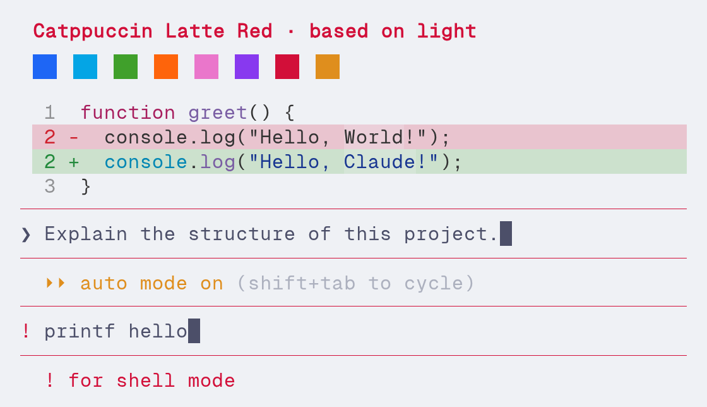](renders/catppuccin-latte-red.png) | Not supplied |

Capture details

Combined screenshot crops from **Claude Code 2.1.278**, using **Geist Mono**.

- **Pixels:** Preserved from the original screenshots.
- **Swatches:** Agent colours.
- **Syntax highlighting:** Regular: `GitHub`.
- **Examples:** Auto mode and a shell prompt.

[Terminal palette source](https://github.com/catppuccin/palette/blob/07d02aa110ef9eb7e7427afca5c73ba9cf7f8ebd/palette.json).

## Catppuccin Latte Rosewater

| Regular | ANSI |
| --- | --- |
| [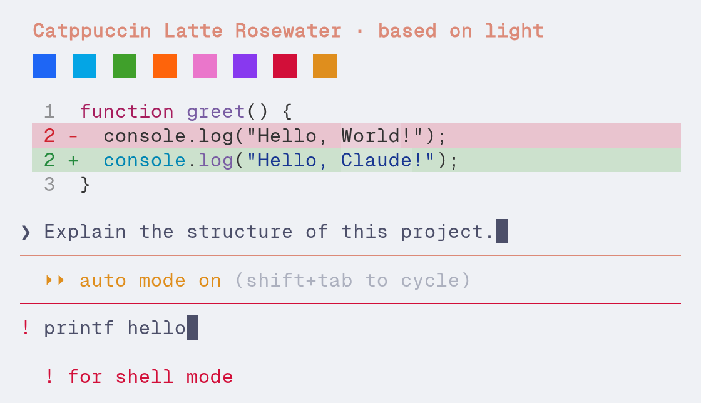](renders/catppuccin-latte-rosewater.png) | Not supplied |

Capture details

Combined screenshot crops from **Claude Code 2.1.278**, using **Geist Mono**.

- **Pixels:** Preserved from the original screenshots.
- **Swatches:** Agent colours.
- **Syntax highlighting:** Regular: `GitHub`.
- **Examples:** Auto mode and a shell prompt.

[Terminal palette source](https://github.com/catppuccin/palette/blob/07d02aa110ef9eb7e7427afca5c73ba9cf7f8ebd/palette.json).

## Catppuccin Latte Sapphire

| Regular | ANSI |
| --- | --- |
| [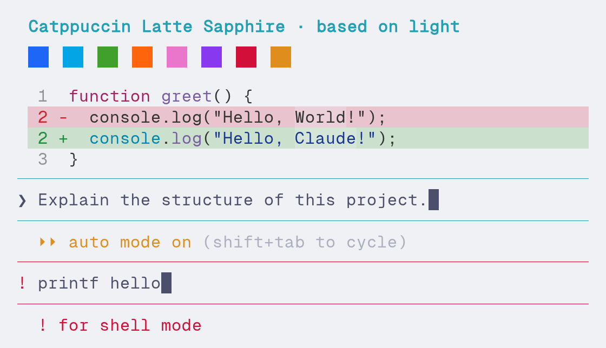](renders/catppuccin-latte-sapphire.png) | Not supplied |

Capture details

Combined screenshot crops from **Claude Code 2.1.278**, using **Geist Mono**.

- **Pixels:** Preserved from the original screenshots.
- **Swatches:** Agent colours.
- **Syntax highlighting:** Regular: `GitHub`.
- **Examples:** Auto mode and a shell prompt.

[Terminal palette source](https://github.com/catppuccin/palette/blob/07d02aa110ef9eb7e7427afca5c73ba9cf7f8ebd/palette.json).

## Catppuccin Latte Sky

| Regular | ANSI |
| --- | --- |
| [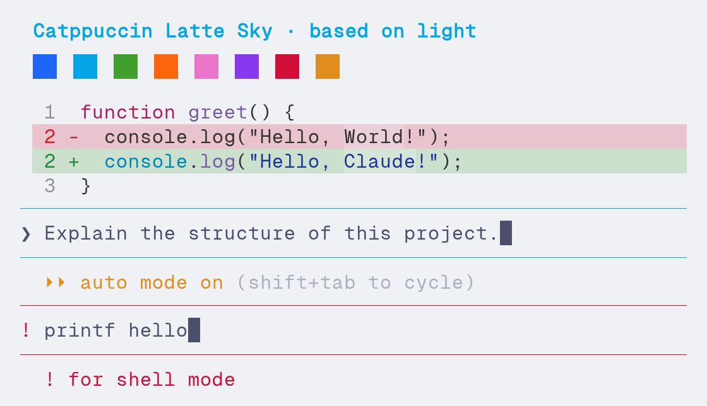](renders/catppuccin-latte-sky.png) | Not supplied |

Capture details

Combined screenshot crops from **Claude Code 2.1.278**, using **Geist Mono**.

- **Pixels:** Preserved from the original screenshots.
- **Swatches:** Agent colours.
- **Syntax highlighting:** Regular: `GitHub`.
- **Examples:** Auto mode and a shell prompt.

[Terminal palette source](https://github.com/catppuccin/palette/blob/07d02aa110ef9eb7e7427afca5c73ba9cf7f8ebd/palette.json).

## Catppuccin Latte Teal

| Regular | ANSI |
| --- | --- |
| [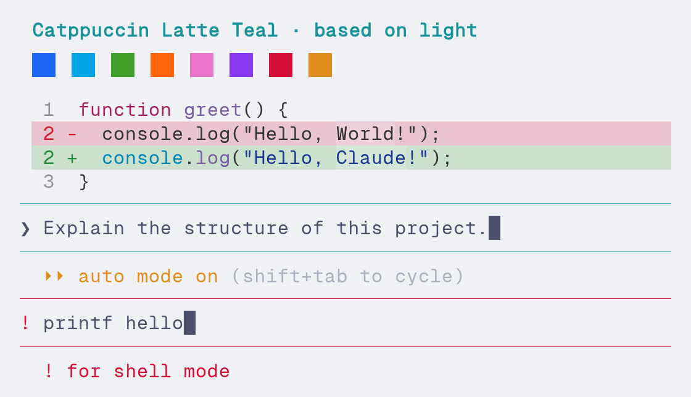](renders/catppuccin-latte-teal.png) | Not supplied |

Capture details

Combined screenshot crops from **Claude Code 2.1.278**, using **Geist Mono**.

- **Pixels:** Preserved from the original screenshots.
- **Swatches:** Agent colours.
- **Syntax highlighting:** Regular: `GitHub`.
- **Examples:** Auto mode and a shell prompt.

[Terminal palette source](https://github.com/catppuccin/palette/blob/07d02aa110ef9eb7e7427afca5c73ba9cf7f8ebd/palette.json).

## Catppuccin Latte Yellow

| Regular | ANSI |
| --- | --- |
| [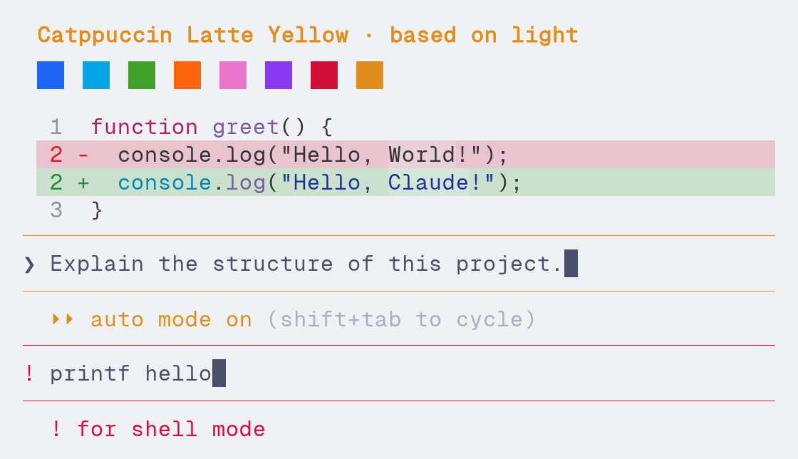](renders/catppuccin-latte-yellow.png) | Not supplied |

Capture details

Combined screenshot crops from **Claude Code 2.1.278**, using **Geist Mono**.

- **Pixels:** Preserved from the original screenshots.
- **Swatches:** Agent colours.
- **Syntax highlighting:** Regular: `GitHub`.
- **Examples:** Auto mode and a shell prompt.

[Terminal palette source](https://github.com/catppuccin/palette/blob/07d02aa110ef9eb7e7427afca5c73ba9cf7f8ebd/palette.json).

## Catppuccin Macchiato Flamingo

| Regular | ANSI |
| --- | --- |
|  | Not supplied |

Capture details

Combined screenshot crops from **Claude Code 2.1.278**, using **Geist Mono**.

- **Pixels:** Preserved from the original screenshots.
- **Swatches:** Agent colours.
- **Syntax highlighting:** Regular: `Monokai Extended`.
- **Examples:** Auto mode and a shell prompt.

[Terminal palette source](https://github.com/catppuccin/palette/blob/07d02aa110ef9eb7e7427afca5c73ba9cf7f8ebd/palette.json).

## Catppuccin Macchiato Green

| Regular | ANSI |
| --- | --- |
| [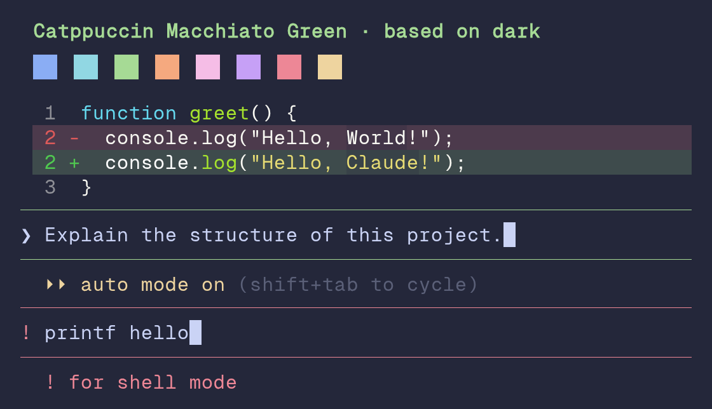](renders/catppuccin-macchiato-green.png) | Not supplied |

Capture details

Combined screenshot crops from **Claude Code 2.1.278**, using **Geist Mono**.

- **Pixels:** Preserved from the original screenshots.
- **Swatches:** Agent colours.
- **Syntax highlighting:** Regular: `Monokai Extended`.
- **Examples:** Auto mode and a shell prompt.

[Terminal palette source](https://github.com/catppuccin/palette/blob/07d02aa110ef9eb7e7427afca5c73ba9cf7f8ebd/palette.json).

## Catppuccin Macchiato Lavender

| Regular | ANSI |
| --- | --- |
| [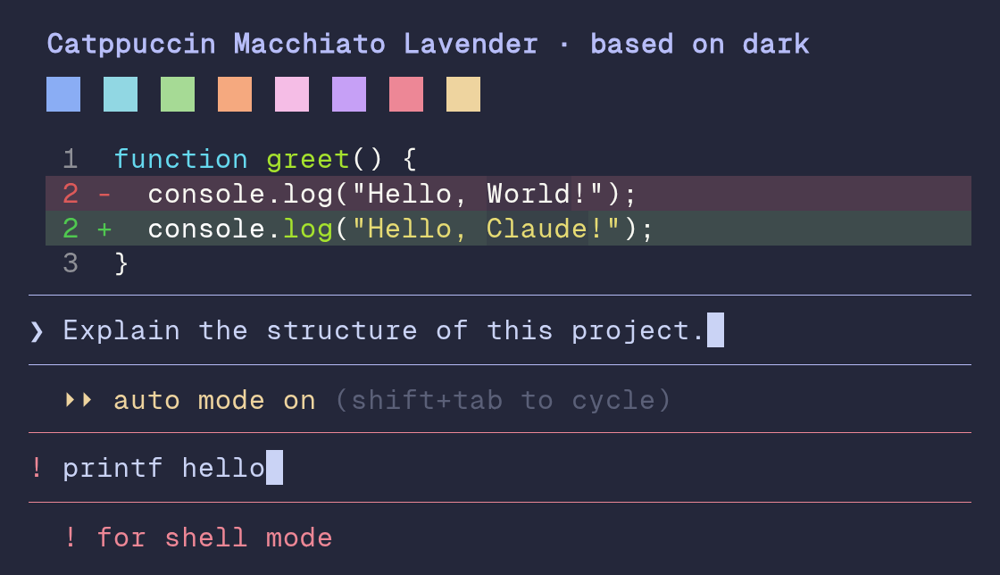](renders/catppuccin-macchiato-lavender.png) | Not supplied |

Capture details

Combined screenshot crops from **Claude Code 2.1.278**, using **Geist Mono**.

- **Pixels:** Preserved from the original screenshots.
- **Swatches:** Agent colours.
- **Syntax highlighting:** Regular: `Monokai Extended`.
- **Examples:** Auto mode and a shell prompt.

[Terminal palette source](https://github.com/catppuccin/palette/blob/07d02aa110ef9eb7e7427afca5c73ba9cf7f8ebd/palette.json).

## Catppuccin Macchiato Maroon

| Regular | ANSI |
| --- | --- |
| [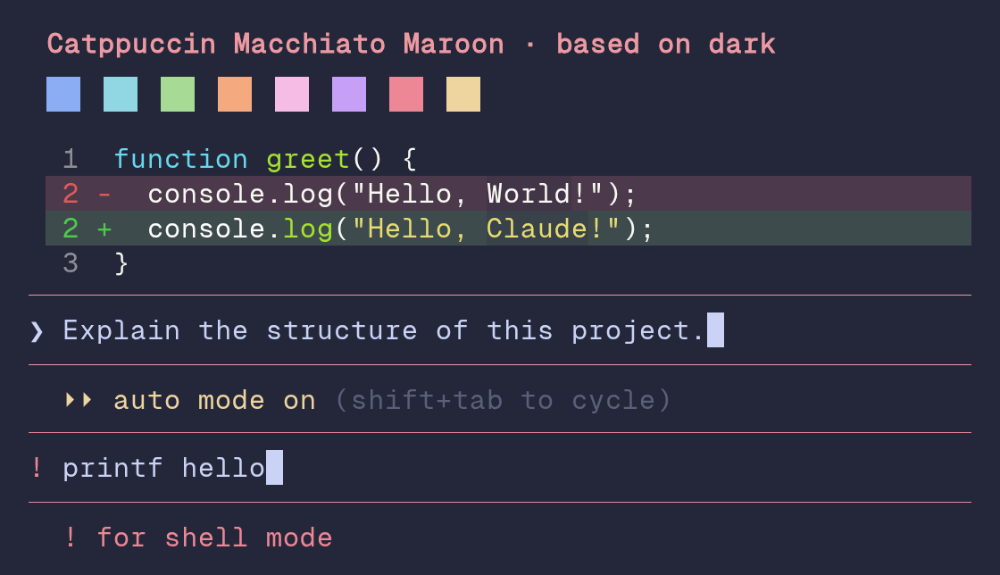](renders/catppuccin-macchiato-maroon.png) | Not supplied |

Capture details

Combined screenshot crops from **Claude Code 2.1.278**, using **Geist Mono**.

- **Pixels:** Preserved from the original screenshots.
- **Swatches:** Agent colours.
- **Syntax highlighting:** Regular: `Monokai Extended`.
- **Examples:** Auto mode and a shell prompt.

[Terminal palette source](https://github.com/catppuccin/palette/blob/07d02aa110ef9eb7e7427afca5c73ba9cf7f8ebd/palette.json).

## Catppuccin Macchiato Mauve

| Regular | ANSI |
| --- | --- |
| [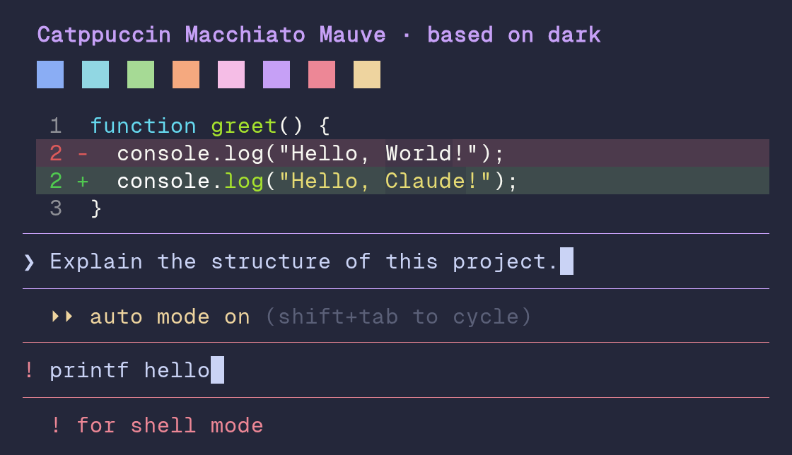](renders/catppuccin-macchiato-mauve.png) | Not supplied |

Capture details

Combined screenshot crops from **Claude Code 2.1.278**, using **Geist Mono**.

- **Pixels:** Preserved from the original screenshots.
- **Swatches:** Agent colours.
- **Syntax highlighting:** Regular: `Monokai Extended`.
- **Examples:** Auto mode and a shell prompt.

[Terminal palette source](https://github.com/catppuccin/palette/blob/07d02aa110ef9eb7e7427afca5c73ba9cf7f8ebd/palette.json).

## Catppuccin Macchiato Peach

| Regular | ANSI |
| --- | --- |
| [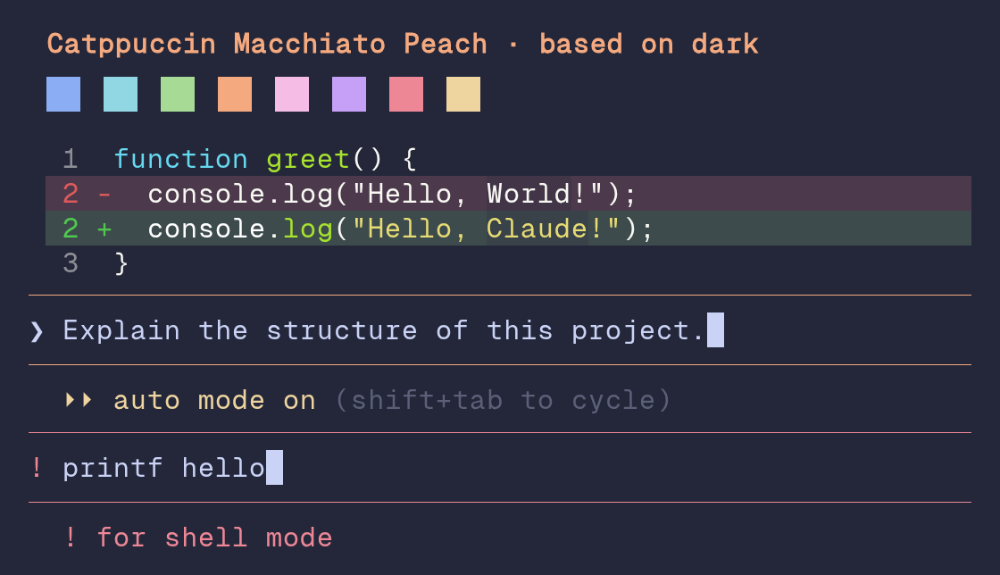](renders/catppuccin-macchiato-peach.png) | Not supplied |

Capture details

Combined screenshot crops from **Claude Code 2.1.278**, using **Geist Mono**.

- **Pixels:** Preserved from the original screenshots.
- **Swatches:** Agent colours.
- **Syntax highlighting:** Regular: `Monokai Extended`.
- **Examples:** Auto mode and a shell prompt.

[Terminal palette source](https://github.com/catppuccin/palette/blob/07d02aa110ef9eb7e7427afca5c73ba9cf7f8ebd/palette.json).

## Catppuccin Macchiato Pink

| Regular | ANSI |
| --- | --- |
| [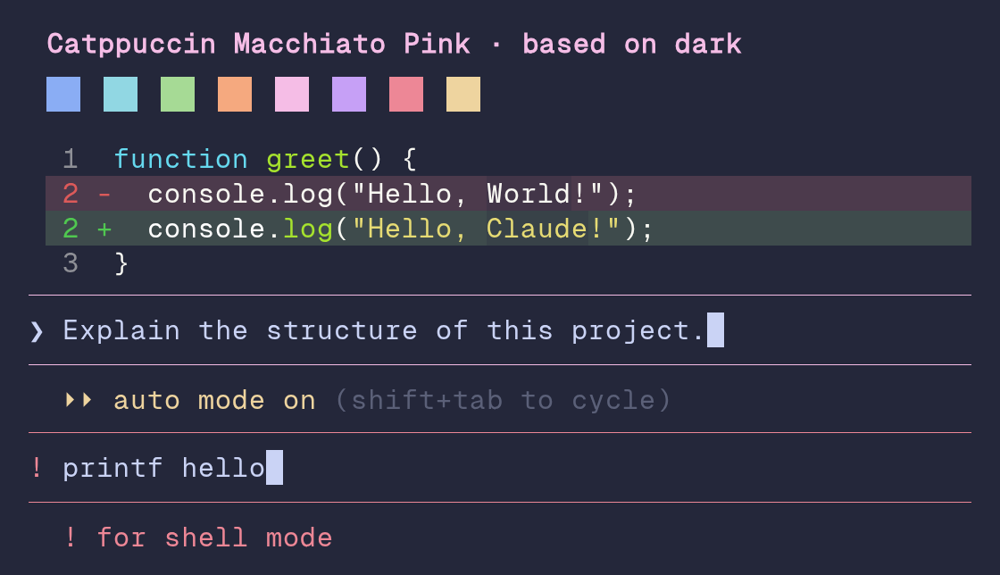](renders/catppuccin-macchiato-pink.png) | Not supplied |

Capture details

Combined screenshot crops from **Claude Code 2.1.278**, using **Geist Mono**.

- **Pixels:** Preserved from the original screenshots.
- **Swatches:** Agent colours.
- **Syntax highlighting:** Regular: `Monokai Extended`.
- **Examples:** Auto mode and a shell prompt.

[Terminal palette source](https://github.com/catppuccin/palette/blob/07d02aa110ef9eb7e7427afca5c73ba9cf7f8ebd/palette.json).

## Catppuccin Macchiato Red

| Regular | ANSI |
| --- | --- |
| [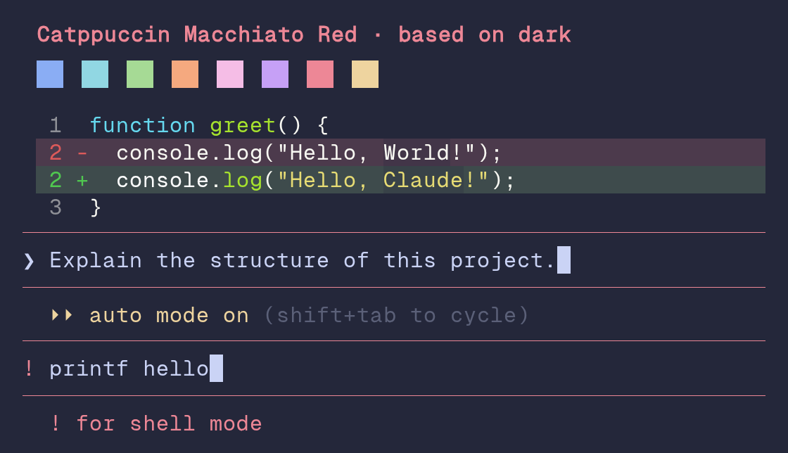](renders/catppuccin-macchiato-red.png) | Not supplied |

Capture details

Combined screenshot crops from **Claude Code 2.1.278**, using **Geist Mono**.

- **Pixels:** Preserved from the original screenshots.
- **Swatches:** Agent colours.
- **Syntax highlighting:** Regular: `Monokai Extended`.
- **Examples:** Auto mode and a shell prompt.

[Terminal palette source](https://github.com/catppuccin/palette/blob/07d02aa110ef9eb7e7427afca5c73ba9cf7f8ebd/palette.json).

## Catppuccin Macchiato Rosewater

| Regular | ANSI |
| --- | --- |
| [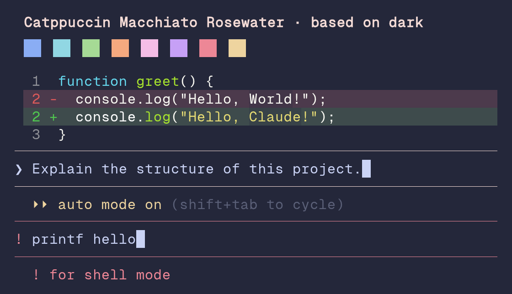](renders/catppuccin-macchiato-rosewater.png) | Not supplied |

Capture details

Combined screenshot crops from **Claude Code 2.1.278**, using **Geist Mono**.

- **Pixels:** Preserved from the original screenshots.
- **Swatches:** Agent colours.
- **Syntax highlighting:** Regular: `Monokai Extended`.
- **Examples:** Auto mode and a shell prompt.

[Terminal palette source](https://github.com/catppuccin/palette/blob/07d02aa110ef9eb7e7427afca5c73ba9cf7f8ebd/palette.json).

## Catppuccin Macchiato Sapphire

| Regular | ANSI |
| --- | --- |
| [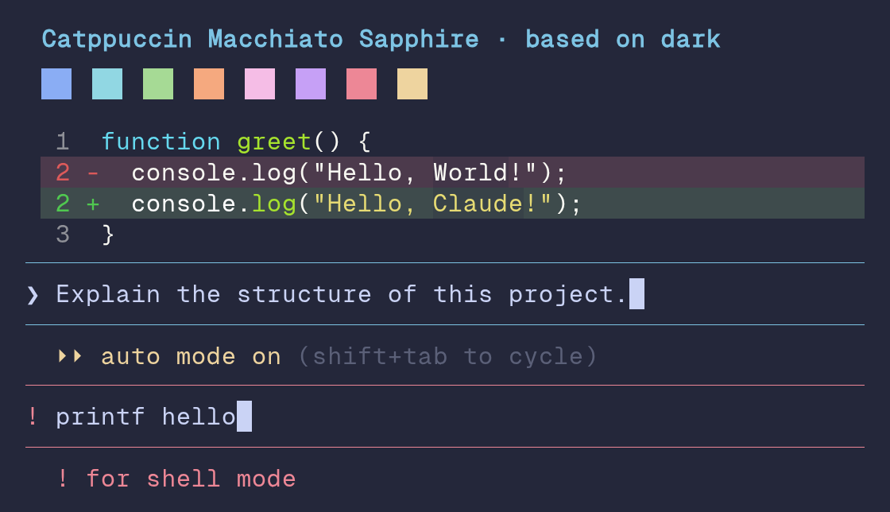](renders/catppuccin-macchiato-sapphire.png) | Not supplied |

Capture details

Combined screenshot crops from **Claude Code 2.1.278**, using **Geist Mono**.

- **Pixels:** Preserved from the original screenshots.
- **Swatches:** Agent colours.
- **Syntax highlighting:** Regular: `Monokai Extended`.
- **Examples:** Auto mode and a shell prompt.

[Terminal palette source](https://github.com/catppuccin/palette/blob/07d02aa110ef9eb7e7427afca5c73ba9cf7f8ebd/palette.json).

## Catppuccin Macchiato Sky

| Regular | ANSI |
| --- | --- |
| [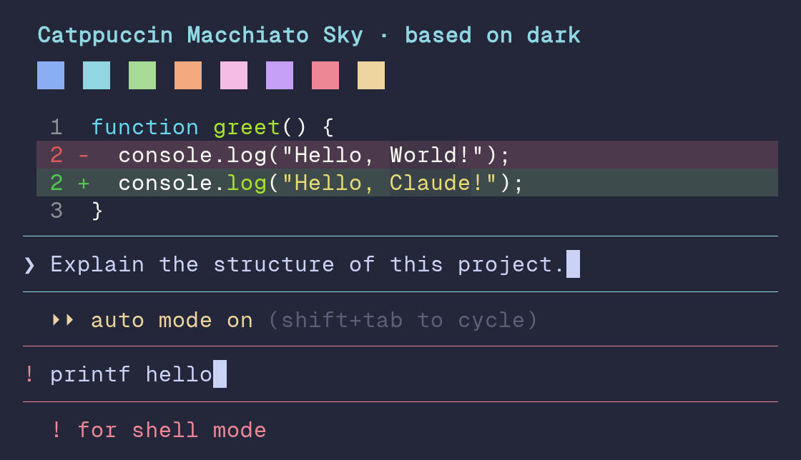](renders/catppuccin-macchiato-sky.png) | Not supplied |

Capture details

Combined screenshot crops from **Claude Code 2.1.278**, using **Geist Mono**.

- **Pixels:** Preserved from the original screenshots.
- **Swatches:** Agent colours.
- **Syntax highlighting:** Regular: `Monokai Extended`.
- **Examples:** Auto mode and a shell prompt.

[Terminal palette source](https://github.com/catppuccin/palette/blob/07d02aa110ef9eb7e7427afca5c73ba9cf7f8ebd/palette.json).

## Catppuccin Macchiato Teal

| Regular | ANSI |
| --- | --- |
| [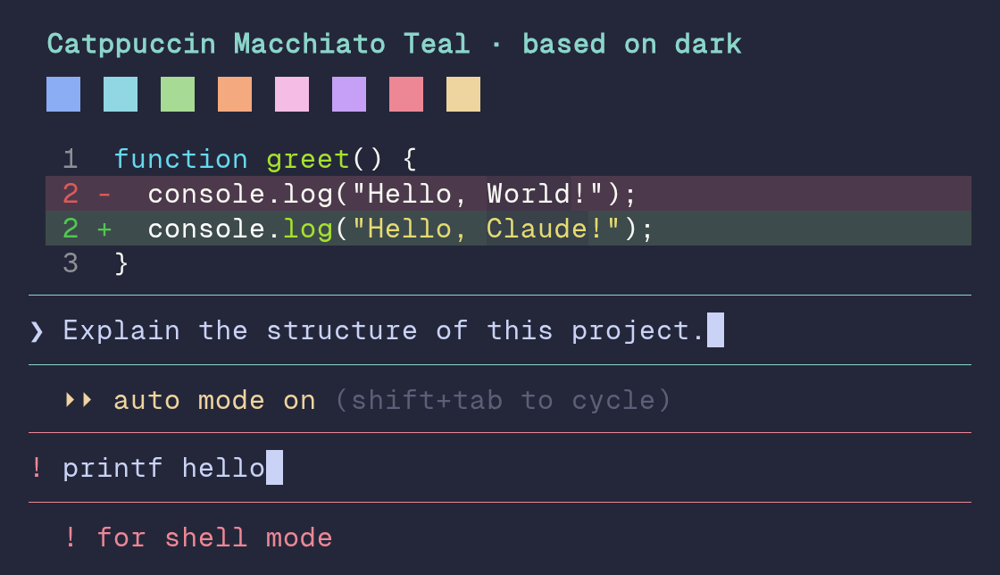](renders/catppuccin-macchiato-teal.png) | Not supplied |

Capture details

Combined screenshot crops from **Claude Code 2.1.278**, using **Geist Mono**.

- **Pixels:** Preserved from the original screenshots.
- **Swatches:** Agent colours.
- **Syntax highlighting:** Regular: `Monokai Extended`.
- **Examples:** Auto mode and a shell prompt.

[Terminal palette source](https://github.com/catppuccin/palette/blob/07d02aa110ef9eb7e7427afca5c73ba9cf7f8ebd/palette.json).

## Catppuccin Macchiato Yellow

| Regular | ANSI |
| --- | --- |
|  | Not supplied |

Capture details

Combined screenshot crops from **Claude Code 2.1.278**, using **Geist Mono**.

- **Pixels:** Preserved from the original screenshots.
- **Swatches:** Agent colours.
- **Syntax highlighting:** Regular: `Monokai Extended`.
- **Examples:** Auto mode and a shell prompt.

[Terminal palette source](https://github.com/catppuccin/palette/blob/07d02aa110ef9eb7e7427afca5c73ba9cf7f8ebd/palette.json).

## Catppuccin Mocha Flamingo

| Regular | ANSI |
| --- | --- |
| [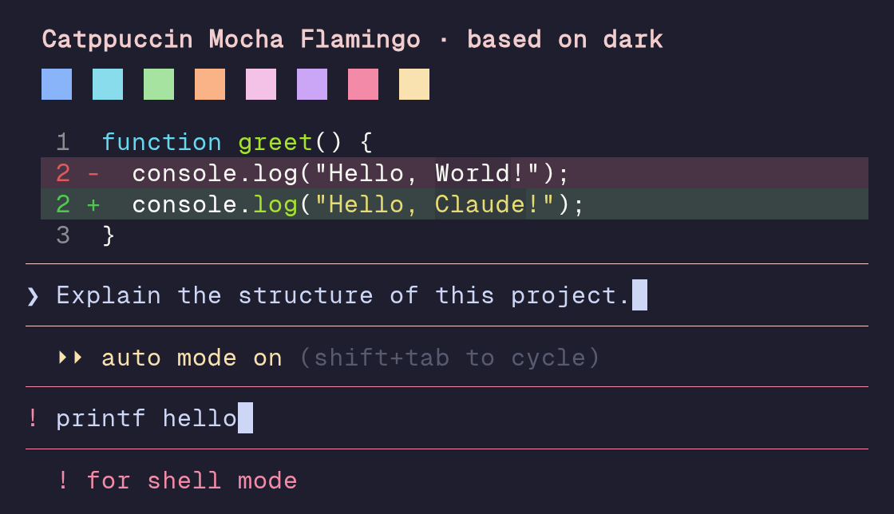](renders/catppuccin-mocha-flamingo.png) | Not supplied |

Capture details

Combined screenshot crops from **Claude Code 2.1.278**, using **Geist Mono**.

- **Pixels:** Preserved from the original screenshots.
- **Swatches:** Agent colours.
- **Syntax highlighting:** Regular: `Monokai Extended`.
- **Examples:** Auto mode and a shell prompt.

[Terminal palette source](https://github.com/catppuccin/palette/blob/07d02aa110ef9eb7e7427afca5c73ba9cf7f8ebd/palette.json).

## Catppuccin Mocha Green

| Regular | ANSI |
| --- | --- |
| [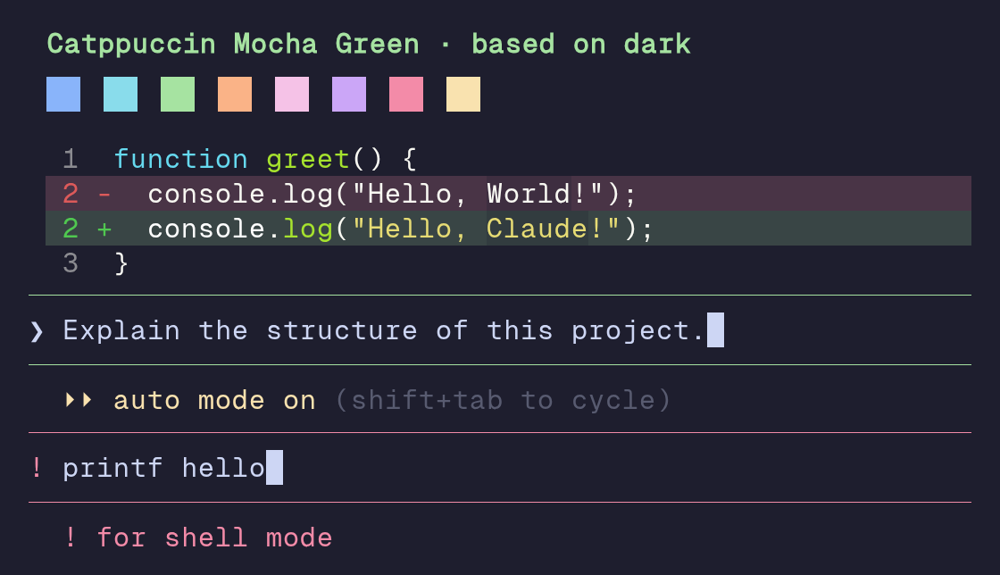](renders/catppuccin-mocha-green.png) | Not supplied |

Capture details

Combined screenshot crops from **Claude Code 2.1.278**, using **Geist Mono**.

- **Pixels:** Preserved from the original screenshots.
- **Swatches:** Agent colours.
- **Syntax highlighting:** Regular: `Monokai Extended`.
- **Examples:** Auto mode and a shell prompt.

[Terminal palette source](https://github.com/catppuccin/palette/blob/07d02aa110ef9eb7e7427afca5c73ba9cf7f8ebd/palette.json).

## Catppuccin Mocha Lavender

| Regular | ANSI |
| --- | --- |
| [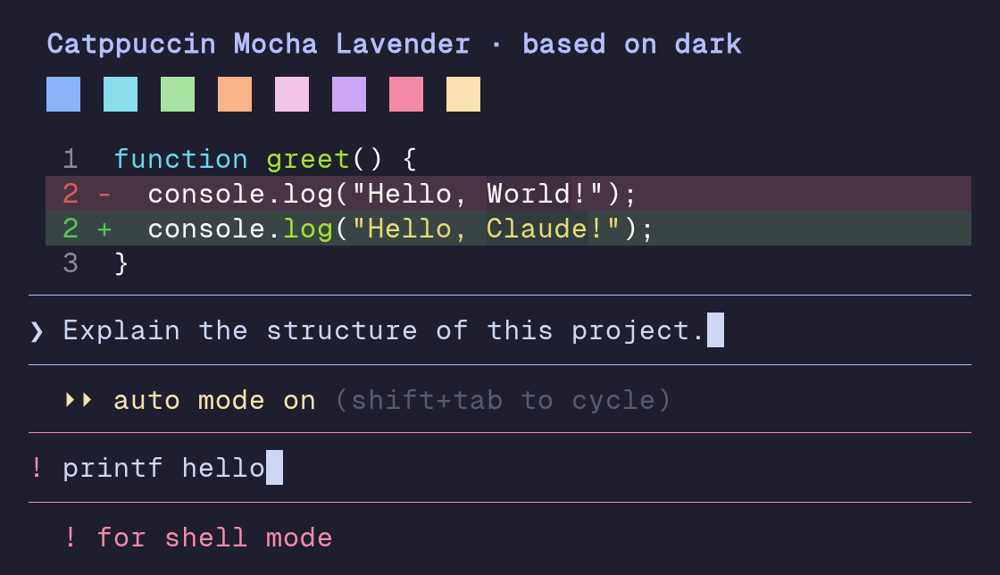](renders/catppuccin-mocha-lavender.png) | Not supplied |

Capture details

Combined screenshot crops from **Claude Code 2.1.278**, using **Geist Mono**.

- **Pixels:** Preserved from the original screenshots.
- **Swatches:** Agent colours.
- **Syntax highlighting:** Regular: `Monokai Extended`.
- **Examples:** Auto mode and a shell prompt.

[Terminal palette source](https://github.com/catppuccin/palette/blob/07d02aa110ef9eb7e7427afca5c73ba9cf7f8ebd/palette.json).

## Catppuccin Mocha Maroon

| Regular | ANSI |
| --- | --- |
| [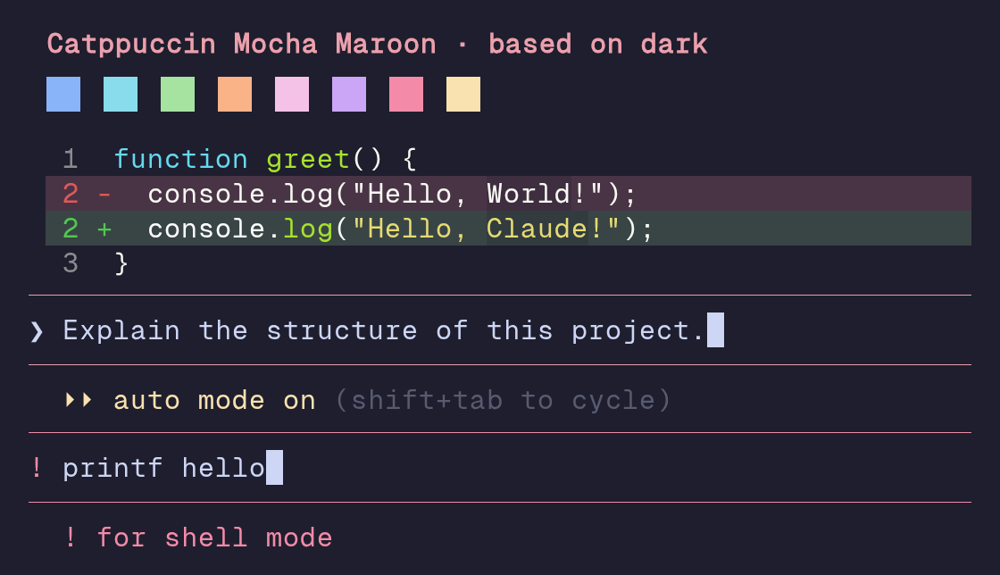](renders/catppuccin-mocha-maroon.png) | Not supplied |

Capture details

Combined screenshot crops from **Claude Code 2.1.278**, using **Geist Mono**.

- **Pixels:** Preserved from the original screenshots.
- **Swatches:** Agent colours.
- **Syntax highlighting:** Regular: `Monokai Extended`.
- **Examples:** Auto mode and a shell prompt.

[Terminal palette source](https://github.com/catppuccin/palette/blob/07d02aa110ef9eb7e7427afca5c73ba9cf7f8ebd/palette.json).

## Catppuccin Mocha Mauve

| Regular | ANSI |
| --- | --- |
| [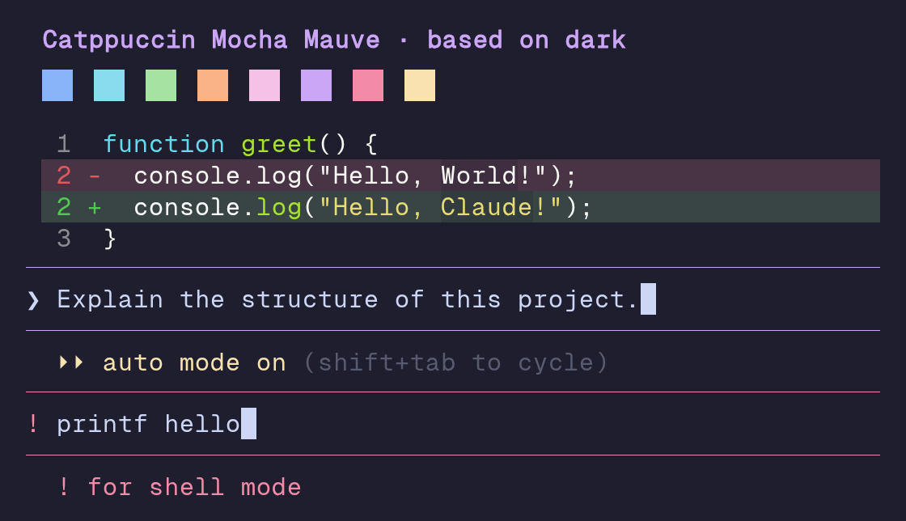](renders/catppuccin-mocha-mauve.png) | Not supplied |

Capture details

Combined screenshot crops from **Claude Code 2.1.278**, using **Geist Mono**.

- **Pixels:** Preserved from the original screenshots.
- **Swatches:** Agent colours.
- **Syntax highlighting:** Regular: `Monokai Extended`.
- **Examples:** Auto mode and a shell prompt.

[Terminal palette source](https://github.com/catppuccin/palette/blob/07d02aa110ef9eb7e7427afca5c73ba9cf7f8ebd/palette.json).

## Catppuccin Mocha Peach

| Regular | ANSI |
| --- | --- |
| [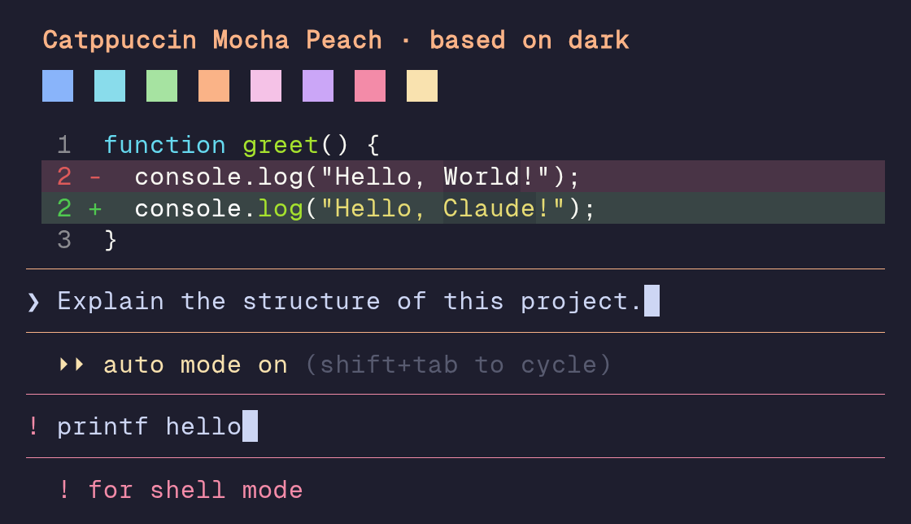](renders/catppuccin-mocha-peach.png) | Not supplied |

Capture details

Combined screenshot crops from **Claude Code 2.1.278**, using **Geist Mono**.

- **Pixels:** Preserved from the original screenshots.
- **Swatches:** Agent colours.
- **Syntax highlighting:** Regular: `Monokai Extended`.
- **Examples:** Auto mode and a shell prompt.

[Terminal palette source](https://github.com/catppuccin/palette/blob/07d02aa110ef9eb7e7427afca5c73ba9cf7f8ebd/palette.json).

## Catppuccin Mocha Pink

| Regular | ANSI |
| --- | --- |
| [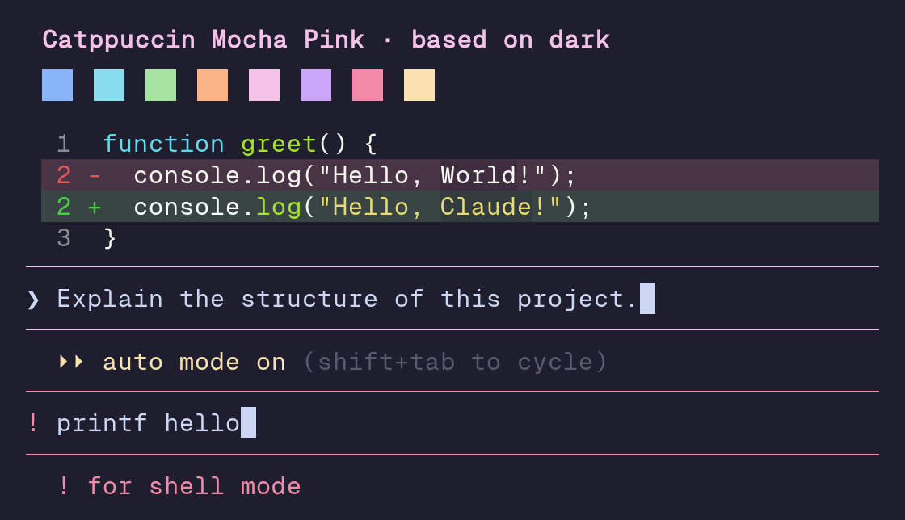](renders/catppuccin-mocha-pink.png) | Not supplied |

Capture details

Combined screenshot crops from **Claude Code 2.1.278**, using **Geist Mono**.

- **Pixels:** Preserved from the original screenshots.
- **Swatches:** Agent colours.
- **Syntax highlighting:** Regular: `Monokai Extended`.
- **Examples:** Auto mode and a shell prompt.

[Terminal palette source](https://github.com/catppuccin/palette/blob/07d02aa110ef9eb7e7427afca5c73ba9cf7f8ebd/palette.json).

## Catppuccin Mocha Red

| Regular | ANSI |
| --- | --- |
| [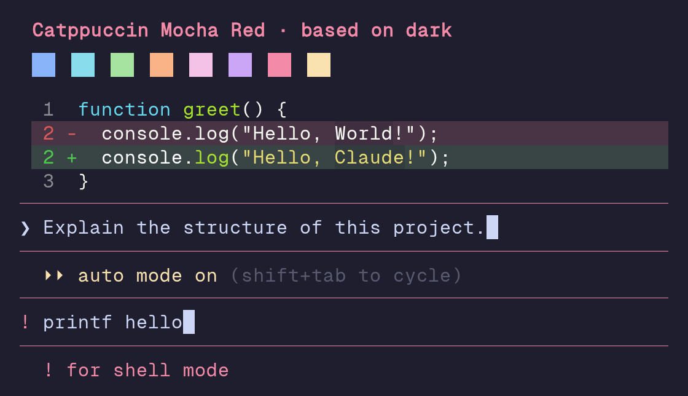](renders/catppuccin-mocha-red.png) | Not supplied |

Capture details

Combined screenshot crops from **Claude Code 2.1.278**, using **Geist Mono**.

- **Pixels:** Preserved from the original screenshots.
- **Swatches:** Agent colours.
- **Syntax highlighting:** Regular: `Monokai Extended`.
- **Examples:** Auto mode and a shell prompt.

[Terminal palette source](https://github.com/catppuccin/palette/blob/07d02aa110ef9eb7e7427afca5c73ba9cf7f8ebd/palette.json).

## Catppuccin Mocha Rosewater

| Regular | ANSI |
| --- | --- |
| [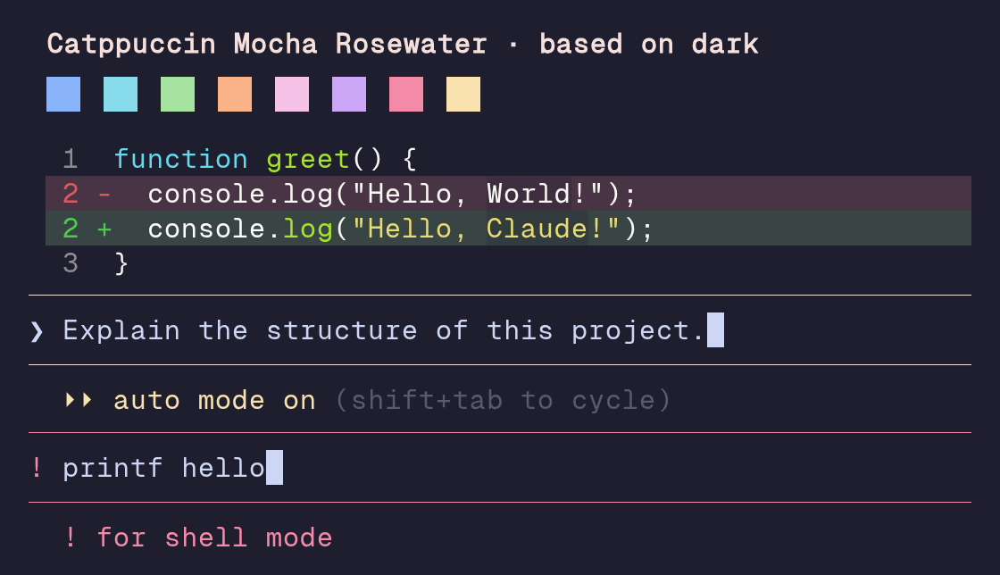](renders/catppuccin-mocha-rosewater.png) | Not supplied |

Capture details

Combined screenshot crops from **Claude Code 2.1.278**, using **Geist Mono**.

- **Pixels:** Preserved from the original screenshots.
- **Swatches:** Agent colours.
- **Syntax highlighting:** Regular: `Monokai Extended`.
- **Examples:** Auto mode and a shell prompt.

[Terminal palette source](https://github.com/catppuccin/palette/blob/07d02aa110ef9eb7e7427afca5c73ba9cf7f8ebd/palette.json).

## Catppuccin Mocha Sapphire

| Regular | ANSI |
| --- | --- |
| [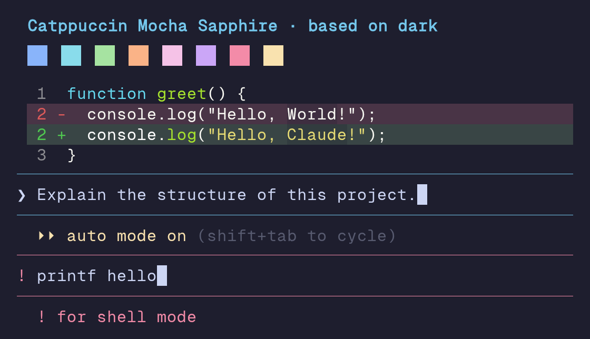](renders/catppuccin-mocha-sapphire.png) | Not supplied |

Capture details

Combined screenshot crops from **Claude Code 2.1.278**, using **Geist Mono**.

- **Pixels:** Preserved from the original screenshots.
- **Swatches:** Agent colours.
- **Syntax highlighting:** Regular: `Monokai Extended`.
- **Examples:** Auto mode and a shell prompt.

[Terminal palette source](https://github.com/catppuccin/palette/blob/07d02aa110ef9eb7e7427afca5c73ba9cf7f8ebd/palette.json).

## Catppuccin Mocha Sky

| Regular | ANSI |
| --- | --- |
| [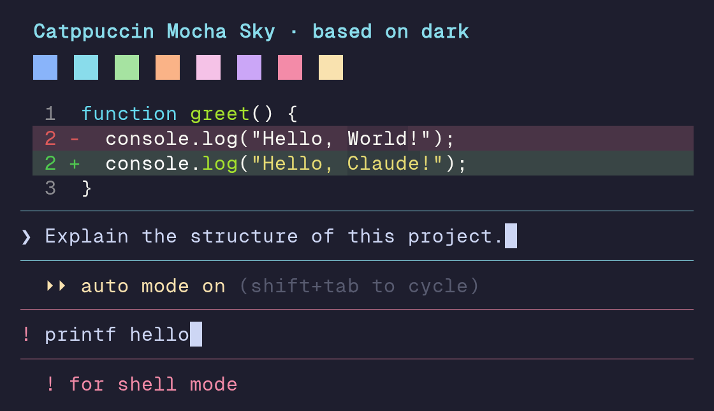](renders/catppuccin-mocha-sky.png) | Not supplied |

Capture details

Combined screenshot crops from **Claude Code 2.1.278**, using **Geist Mono**.

- **Pixels:** Preserved from the original screenshots.
- **Swatches:** Agent colours.
- **Syntax highlighting:** Regular: `Monokai Extended`.
- **Examples:** Auto mode and a shell prompt.

[Terminal palette source](https://github.com/catppuccin/palette/blob/07d02aa110ef9eb7e7427afca5c73ba9cf7f8ebd/palette.json).

## Catppuccin Mocha Teal

| Regular | ANSI |
| --- | --- |
| [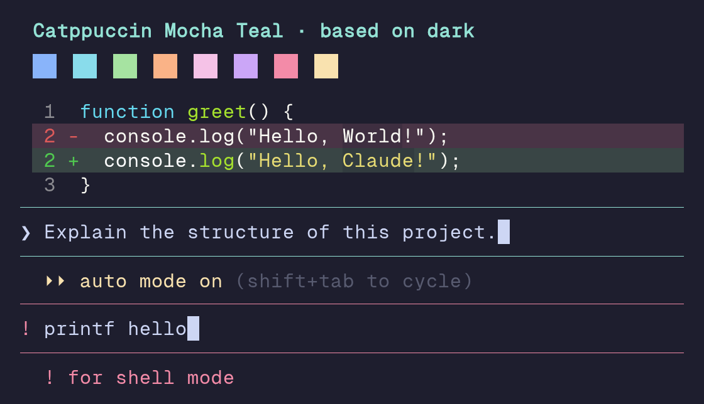](renders/catppuccin-mocha-teal.png) | Not supplied |

Capture details

Combined screenshot crops from **Claude Code 2.1.278**, using **Geist Mono**.

- **Pixels:** Preserved from the original screenshots.
- **Swatches:** Agent colours.
- **Syntax highlighting:** Regular: `Monokai Extended`.
- **Examples:** Auto mode and a shell prompt.

[Terminal palette source](https://github.com/catppuccin/palette/blob/07d02aa110ef9eb7e7427afca5c73ba9cf7f8ebd/palette.json).

## Catppuccin Mocha Yellow

| Regular | ANSI |
| --- | --- |
| [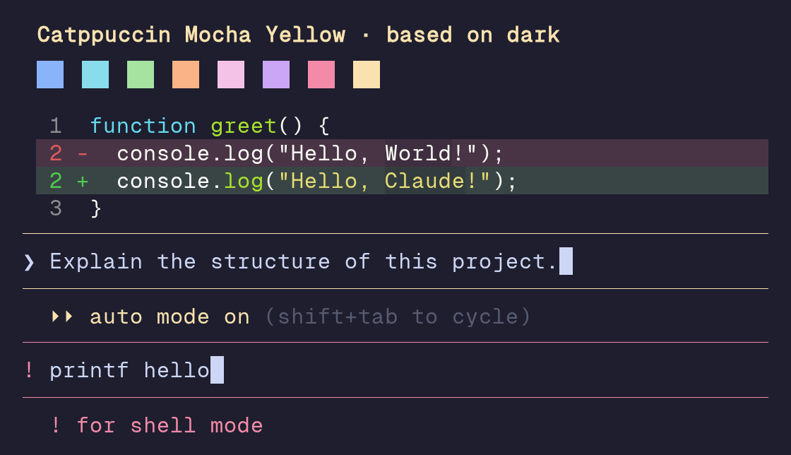](renders/catppuccin-mocha-yellow.png) | Not supplied |

Capture details

Combined screenshot crops from **Claude Code 2.1.278**, using **Geist Mono**.

- **Pixels:** Preserved from the original screenshots.
- **Swatches:** Agent colours.
- **Syntax highlighting:** Regular: `Monokai Extended`.
- **Examples:** Auto mode and a shell prompt.

[Terminal palette source](https://github.com/catppuccin/palette/blob/07d02aa110ef9eb7e7427afca5c73ba9cf7f8ebd/palette.json).

